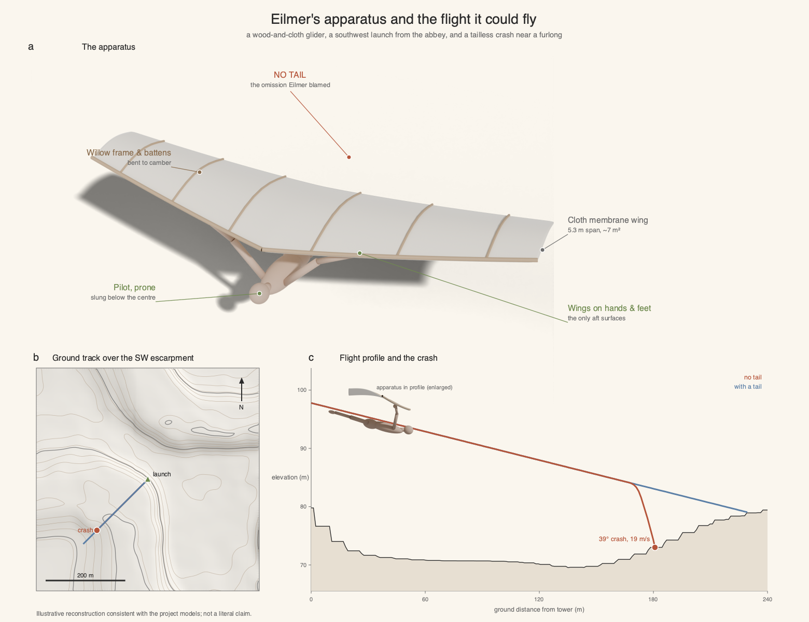

# Eilmer of Malmesbury: a flight-feasibility study

A reproducible engineering analysis of the ~11th-century glide of Eilmer of
Malmesbury, reported by William of Malmesbury in the *Gesta Regum Anglorum*: a
monk who fixed wings to his hands and feet, glided from a tower for "more than a
furlong" (about 200 m), broke both legs, and blamed the failure on having no
tail.

This repository contains the full analysis pipeline and the LaTeX manuscript. Every
figure and number in the paper rebuilds from the code here with a single command.



## What the study finds

- **Site.** The abbey sits on a SW-facing escarpment aligned with the prevailing
  wind, the geometric precondition for ridge lift.
- **Wind.** Over twenty years of ERA5 reanalysis, a launchable SW wind
  (5–12 m/s) occurs in 15.6% of hours per year.
- **Glide.** A still-air glide needs a sailplane-class glide ratio (L/D 11.1);
  ridge lift brings 200 m within reach of a crude cambered wing (L/D 3–7) above
  ~3.6 m/s of wind.
- **Stability.** A tailless hand-and-foot wing is statically unstable for every
  reachable pilot CG; its pitch error doubles in a median 0.27 s against a ~20 s
  flight. A tail removes the divergence.
- **Injury.** The predicted out-of-control arrival breaks both legs yet stays
  survivable, matching the reported injury.

The account is internally consistent and Eilmer's own diagnosis (the missing tail)
is correct.

## Repository layout

```
analysis/        per-workstream code; each folder has:
  terrain/         process_*.py (stats -> metrics.json), plot_*.py (reads metrics),
  weather/         fetch_*.py (keyless data download), and a short *_overview.md
  aero/
  synthesis/       Monte Carlo over the unknown apparatus and launch day
  biomech/         impact biomechanics (broken-legs constraint)
config/          shared plotting style (palette, save_fig)
data/raw/        source data + DATA_SOURCES_AND_METHODOLOGY.md
data/processed/  derived datasets (.npz) that back each figure
figures/         generated figures (PDF + 300-dpi PNG) and CAPTIONS.md
paper_source/    LaTeX manuscript (main.tex, sections/, references.bib, main.pdf)
run_all.sh       rebuild every dataset and figure, then compile the paper
```

Code style: each workstream splits `process_*` (computation, writes
`metrics.json`) from `plot_*` (reads `metrics.json`, draws the figure). The
`metrics.json` files are the single source of truth for every number in the paper.

## Reproduce

Requires Python 3.12. Using [uv](https://docs.astral.sh/uv/):

```bash
uv venv && uv pip install -r requirements.txt
./run_all.sh
```

Or with plain pip:

```bash
python3 -m venv .venv && . .venv/bin/activate
pip install -r requirements.txt
./run_all.sh
```

`run_all.sh` fetches the public input data, regenerates every `.npz` and figure,
and (if `latexmk` and a TeX distribution are present) compiles the manuscript. The
`fetch_*.py` steps need network access on the first run; afterwards the cached
`data/` lets the figures rebuild offline.

## Data sources

All inputs are open and keyless:

- **Wind:** ECMWF ERA5 reanalysis via the [Open-Meteo Historical Weather API](https://open-meteo.com/en/docs/historical-weather-api).
- **Terrain:** [AWS Terrain Tiles](https://registry.opendata.aws/terrain-tiles/) (~6 m posting).

See `data/raw/DATA_SOURCES_AND_METHODOLOGY.md` for details. Site: Malmesbury Abbey,
51.5846° N, 2.0997° W.

## Note on Figure 1

The lead composite (`figures/apparatus_flight.png`) is an illustrative
reconstruction consistent with the glide and stability models, not a literal
depiction. It is shipped as a static asset; its rendering pipeline is not part of
this reproducibility repository and is available on request.

## Citation

If you use this code or its results, please cite the paper (see `CITATION.cff`).

## License

Code is released under the MIT License (see `LICENSE`). The manuscript text and
figures are © 2026 David H. Silver; reuse of the figures is permitted with
attribution.
