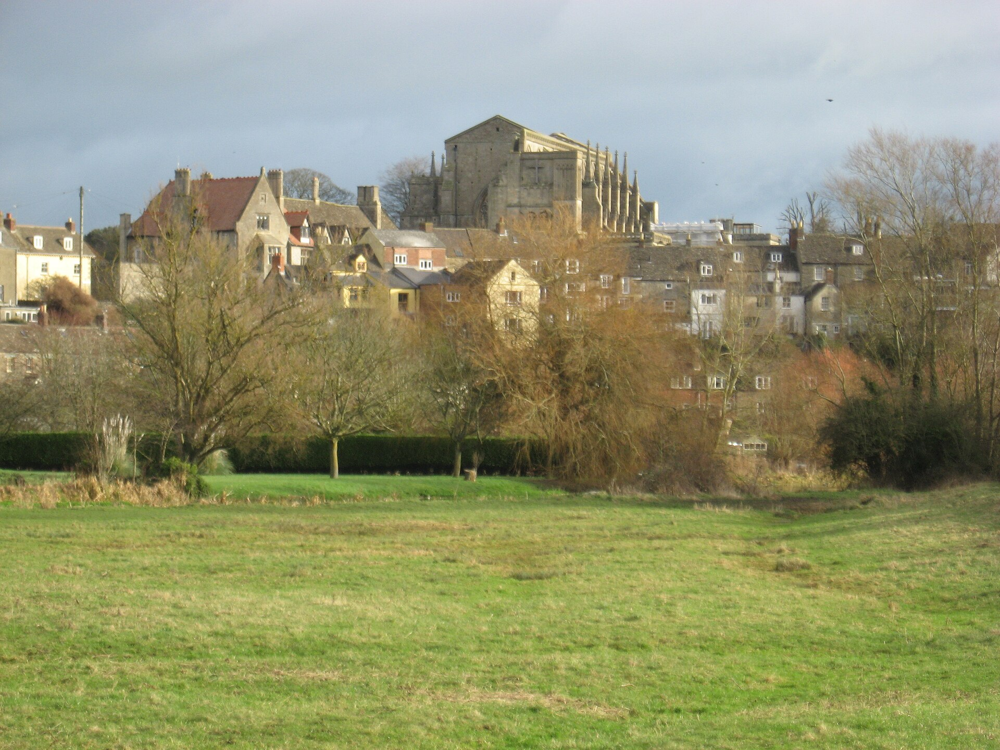

# Eilmer of Malmesbury: a flight-feasibility study

[](https://doi.org/10.5281/zenodo.20706321)
[](LICENSE)

Analysis code and LaTeX manuscript for a study of the eleventh-century flight of
Eilmer of Malmesbury, reported by William of Malmesbury in the *Gesta Regum
Anglorum*: a monk who fixed wings to his hands and feet, launched from a tower,
travelled "more than a furlong" (about 200 m), broke both legs, and blamed the fall
on having no tail. The study tests whether that account is consistent with
elementary flight physics, and sets each step as a student exercise.



*Malmesbury Abbey from the water meadows southwest of the abbey. Photograph: Dr
Duncan Pepper, 2012, via Geograph and Wikimedia Commons, CC BY-SA 2.0.*

## Version 1.1.1: revised manuscript and re-rendered Figure 3

The text is shortened for the journal revision; the model and its results are those of
1.1.0. Every model number in the text is now a macro generated from the `metrics.json`
files by `analysis/export_numbers.py`, so no number is typed by hand. Figure 3 (the
nominal apparatus) is re-rendered with Blender Cycles from the model geometry, and its wing
now has the labelled 7 m² planform area (the earlier mesh had about 6.4 m²). The render
pipeline is in `viz/hero/` (see [Figure 3 render](#figure-3-render)).

## Version 1.1.0: corrected glide model

Version 1.0.0 contained an error in the glide model: the ground range used the
airspeed instead of the airspeed minus the headwind, which overstated the range of
a craft flying into the wind by about a factor of two. It also assumed the craft
left the tower already at gliding speed. Version 1.1.0 corrects both, and the
results below supersede those of 1.0.0.

The glide is now integrated in time from a standing launch (`analysis/aero/flight.py`),
with the wind subtracted from the ground speed, ridge lift confined to the measured
extent of the slope, and the craft landing on the terrain. Two tracks are flown:
straight out over the valley into the wind, and along the southwest-facing slope in
ridge lift. The glide ratio is derived from a drag polar with bounded aspect ratio,
span efficiency, and zero-lift drag, instead of being sampled directly.

## What the study finds

- **Launch.** Leaving the tower at walking pace, the craft must lose about 11.5 m of
  height to reach its 15.1 m/s flying speed, so a long flight needs a strong wind.
- **Into the wind.** None of 40,000 sampled apparatus and launch-day cases reaches
  200 m flying straight out over the valley.
- **Along the slope.** 6.9% of cases reach 200 m in ridge lift (95% CI 6.6–7.1%),
  with a median launch wind of 7.6 m/s and the better wings (median L/D 5.8).
- **Stability.** Without a tail the wing diverges in pitch, with a median doubling
  time of 0.29 s, comparable to human reaction time, during a flight of about 24 s.
  A tail removes the divergence.
- **Injury.** A controlled glide that hits the ground without a flare arrives at no
  more than 4.1 m/s vertically, below the lowest leg-fracture speed (6.1 m/s). The
  broken legs need a fast, steep arrival, which a loss of pitch control provides.

The account is physically possible but marginal, and the missing tail is a
sufficient cause of the fall.

## Repository layout

```
analysis/          one folder per workstream; process_*.py writes metrics.json,
  terrain/           plot_*.py reads it and draws the figure, fetch_*.py downloads
  weather/           the public input data
  aero/              flight.py: the shared standing-launch glide integrator
  synthesis/         Monte Carlo over the unknown apparatus and launch day
  biomech/           impact and leg fracture
  export_numbers.py  metrics.json -> paper_source_iop/numbers.tex (every number in the text)
config/            shared plotting style
data/raw/          wind data, the abbey photograph (photos/SOURCE.md), data notes
data/processed/    derived datasets (.npz) behind each figure
figures/           generated figures (PDF and PNG)
paper_source_iop/  LaTeX manuscript: main.tex, supplementary.tex, sections/, main.pdf
viz/hero/          Blender render of Figure 3 (final/) and the cover images (scene/);
  assets/            monk.py (the pilot), monk_prone.blend, fetch_assets.sh, LICENSES.md
run_all.sh         rebuild every dataset, figure, and number, then compile the paper
```

## Reproduce

Requires Python 3.12. Using [uv](https://docs.astral.sh/uv/):

```bash
uv venv && uv pip install -r requirements.txt
./run_all.sh
```

Or with pip:

```bash
python3 -m venv .venv && . .venv/bin/activate
pip install -r requirements.txt
./run_all.sh
```

`run_all.sh` fetches the input data, regenerates every `.npz`, figure, and
`numbers.tex`, and compiles the manuscript if `latexmk` and a TeX distribution are
present. The fetch steps need network access on the first run. Figure 3
(`figures/fig_apparatus.png`) is committed and is re-rendered only with `RENDER_FIG3=1`.

### Figure 3 render

The render needs Blender's Python module (`bpy` 5.0.1, Python 3.11) in its own venv, the
CC0 assets downloaded by `fetch_assets.sh` (about 300 MB; not redistributed here, see
`viz/hero/assets/LICENSES.md`), GNU `timeout` and the cairo library for the labels:

```bash
uv venv --python 3.11 .venv-bpy && uv pip install --python .venv-bpy/bin/python bpy==5.0.1
uv pip install -r viz/hero/requirements-render.txt      # drawsvg, cairosvg (main .venv)
brew install coreutils cairo
viz/hero/assets/fetch_assets.sh
RENDER_FIG3=1 ./run_all.sh
```

`render_fig3_v5.py` renders the main view (1024 samples) and the inset (768 samples) with
Cycles, then `compose_fig3_v6.py` draws the labels from `analysis/aero/metrics.json`. On an
Apple M4 Max (40-core GPU, Metal) the main view takes about 2 minutes and the inset about
25 s; `run_all.sh` caps them at 15 and 10 minutes. A re-render in a clean clone matched the
committed figure to within 3/255 per pixel. For a quick check add `--pct 25 --samples 64`. The pilot is the cached
`monk_prone.blend`; rebuilding it with `viz/hero/assets/monk.py` (MakeHuman via MPFB2,
`fetch_assets.sh --monk`) runs a cloth simulation. `viz/hero/final/measure_area.py`
prints the planform area of the old and new wing meshes. The cover images
(`viz/hero/scene/render_scene.py`) need `fetch_assets.sh --covers` (sky HDRIs, about 1 GB).

## Data sources

- **Wind:** ECMWF ERA5 reanalysis via the [Open-Meteo Historical Weather API](https://open-meteo.com/en/docs/historical-weather-api).
- **Terrain:** [AWS Terrain Tiles](https://registry.opendata.aws/terrain-tiles/) (about 6 m grid).
- **Photograph:** Wikimedia Commons, CC BY-SA 2.0 (see `data/raw/photos/SOURCE.md`).
- **Render assets:** MakeHuman and Poly Haven, CC0 1.0 (see `viz/hero/assets/LICENSES.md`).

See `data/raw/DATA_SOURCES_AND_METHODOLOGY.md`. Site: Malmesbury Abbey, 51.5846° N,
2.0997° W.

## Citation

Please cite the paper (see `CITATION.cff`).

## License

Code is released under the MIT License (see `LICENSE`). The manuscript text and
figures are © 2026 David H. Silver; reuse of the figures is permitted with
attribution. The abbey photograph is © Dr Duncan Pepper, CC BY-SA 2.0.
